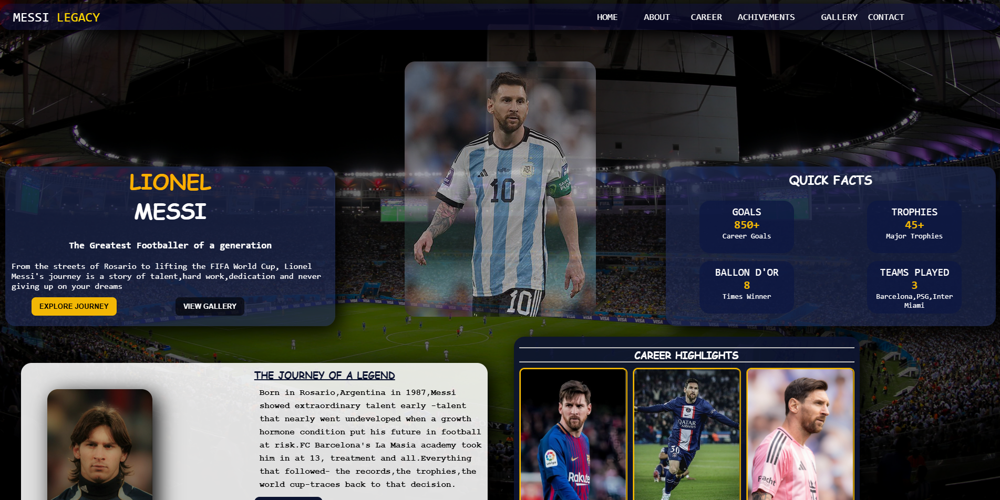
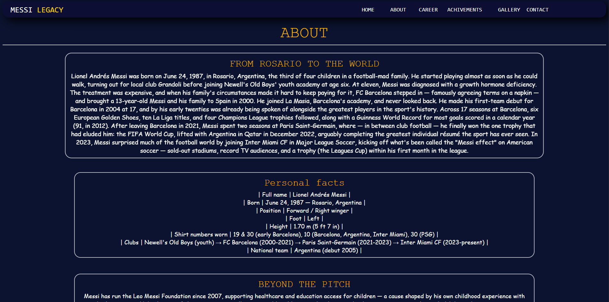
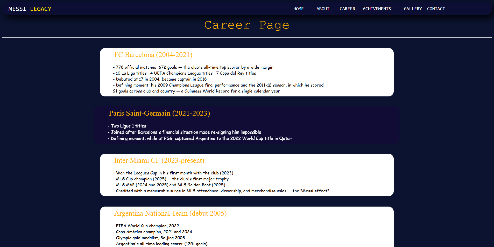
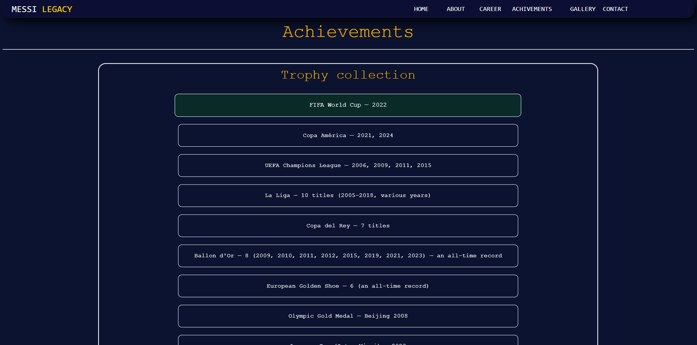
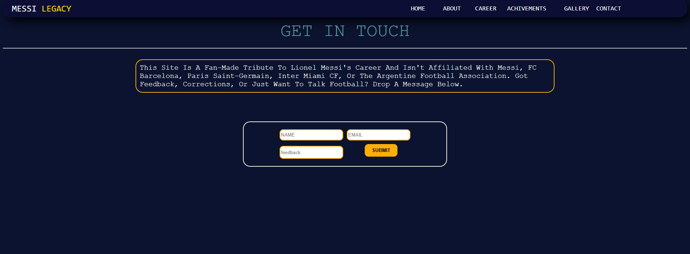

# Messi-Legacy

This is one of my best projects, made with HTML and CSS from two months of experience.

It is a simple website called Messi-Legacy. It's about LIONEL MESSI and his career.

It is an inspirational page for youngsters who dream of being like him. His entire career is in one website. This is an unofficial page just to encourage and inspire.


## Live Demo

[Open the live website](https://raphelreji.github.io/Messi-Legacy/)

## Screenshots







## Features

- Almost all information about messi
- Animation in almost every card
- Maintained a theme
- feedback option(but fake)
- clean format

## Built With

- HTML
- CSS

## Installation to run locally

1. Clone this repository:

   ```bash
   git clone https://github.com/RaphelReji/Messi-Legacy.git
   ```

2. Open the project folder in VS Code.

3. Open `index.html` in your browser.

### How It Works

You can explore the messi's career through the webpage with a blended theme of navy and gold etc...

## Design

I designed it with a theme of navy and gold,used white and navy in almost every cards and used courier,monospace as fonts.

## Challenges

My main challenge was working with images. Some were big and some were small, but I managed to solve the issue.


## What I Learned

- Lot of html,css concepts as a beginner
- learned to make the div and grids

## Credits

* Images and assets: Copyright belongs to their rightful owners.
* Content: Used Claude to get information about Messi (like his goals, teams, etc.).


## License

This project was created for Hack Club under MIT-do what ever with it.
